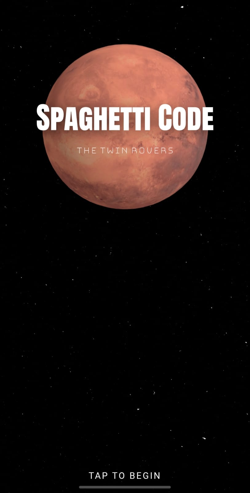
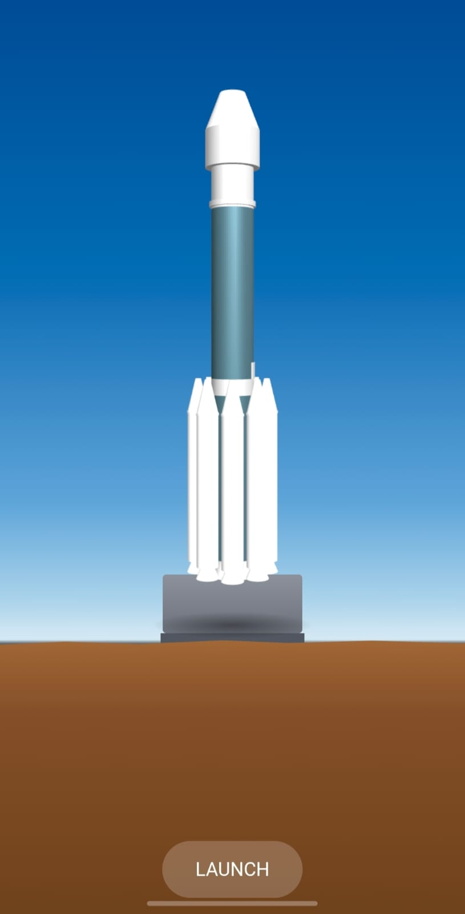
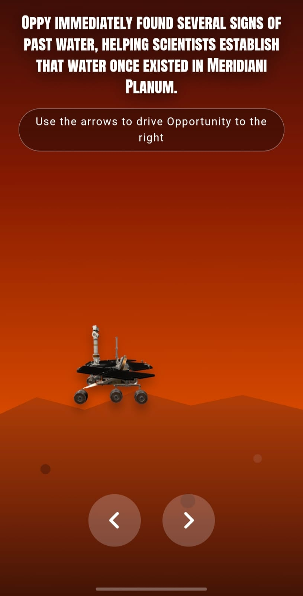

# Spaghetti Code: The Twin Rovers

An interactive, voiced and 3D story about the Mars rover **Opportunity ("Oppy")**, made for school-aged space enthusiasts.

<!-- Live demo: add your Vercel link here -->

<p align="center">
  
  &nbsp;
  
  &nbsp;
  
</p>

<p align="center"><em>The home page, the launch, and the rover on Mars.</em></p>

---

## Problem Definition

Presenting past space missions often lacks the spark of imagination and storytelling that a younger or more casual audience needs to stay interested. This matters because probes, rovers and spaceships have added so much to human knowledge over the years, and their legacy must be honored.

## Our Solution

We built a website that tells the story of the Opportunity rover (Oppy) in an engaging and simplified way, suitable for school-aged space enthusiasts. Our goal was to create an emotional and authentic experience that follows Oppy through its mission on Mars, showing both its achievements and the hardships it faced.

What makes the website unique:

- **3D models** that give the story an interesting look.
- **Interactive story elements** that make the user more involved in the storytelling.
- **Voiceover** for every main scene.

The website is built with **HTML, CSS and vanilla JavaScript**, and uses the **Three.js** library to bring the 3D models into the page.

---

## Features

### The Story

The project presents the story in a simplified and engaging way.

- It starts with the mission of the twin rovers, **Spirit** and **Opportunity**.
- It follows Opportunity from its launch aboard a **Delta II** rocket until its arrival on Mars.
- It then tells about Opportunity's discoveries and the difficulties it faced along the way, such as a damaged wheel and a severe dust storm.
- It shows how the rover's discoveries helped scientists answer the mystery of **ancient water on Mars**.

### The Interactivity

- Building the capsule that carries the rover, piece by piece.
- Launching the rocket.
- Moving the rover with arrow buttons in different situations (on a normal road, with a damaged wheel, and during a storm).

The interactive parts are easy to understand, and the instructions on screen are written in a clear way.

### The Voiceover

Every main story scene is voiced. Hearing the story read aloud makes the experience more immersive, and it helps people with disabilities such as dyslexia to enjoy the content more easily. In every scene, the Continue button appears only after the voice ends.

### The 3D Models

- Some of the models come from **NASA 3D Resources**.
- The rest were made from scratch by our 3D artist, such as the **rocket** and the **capsule**.
- One model, **Mars with water**, comes from a free-to-use 3D model, which our 3D artist modified to fit the style of the project.

---

## Tech Stack

| Part | Technology |
|---|---|
| Structure | HTML |
| Style and animation | CSS (hand-written, plus a few Tailwind utility classes) |
| Logic | Vanilla JavaScript (ES modules) |
| 3D | [Three.js](https://threejs.org/) (GLB models) |
| Audio | Voiceover and sound effects (mp3 / mp4) |
| Hosting | Vercel |

---

## Project Structure

```
index.html
style.css
scripts/
  main.js        the main Mars globe, intro voice and background music
  carousel.js    the story controller (rover carousel and all the chapters)
  viewer.js      a small reusable 3D model viewer
  rocket.js      the capsule puzzle and the rocket launch
  voice.js       voiceover helper
models/          3D models (.glb)
images/          images and README screenshots
soundEffects/    sound effects and background music
voiceover/       voiceover files
```

---

## Run Locally

The page uses JavaScript modules, so it must be opened through a local server (not by double-clicking `index.html`).

```bash
git clone https://github.com/yadragon2007/Spaghetti-Code.git
cd Spaghetti-Code
npx serve .
```

Then open the address shown in the terminal. You can also use the **Live Server** extension in VS Code.

> Tip: the site is designed for phones (a narrow column), so it looks best in a phone-sized window or in your browser's device mode.

---

## Options for Further Development

- **Spirit rover:** the project currently focuses on Opportunity, but it already has a "Coming Soon" section for its twin, Spirit, which explored the opposite side of Mars.
- The site is built to expand easily with more inspiring stories of Martian exploration, which sets it up for continuous growth and future updates. Possible additions:
  - The **Ingenuity** helicopter.
  - The **Sojourner** rover, the first wheeled vehicle to operate on Mars.
  - Derelict Martian orbiters.
- Beyond Mars, a new section could cover derelict equipment currently on the **Moon**.

---

## Credits

- 3D models: NASA 3D Resources, our 3D artist, and a free-to-use Mars model modified by our 3D artist.
- Story, design and development: the Spaghetti Code team.
- 3D engine: [Three.js](https://threejs.org/).
